 

## About

I'm a **developer** focused on systems design, interface design, and the 3D pipelines that feed them. I treat AI agents as part of the toolchain: I direct them through small, verified steps so I can prototype quickly without giving up polish or reliability.

I care about the details that make an experience feel premium: consistent UI, readable type, smooth motion, and systems that behave the same way every time.

## Focus

## Toolbox

## How I work

| | |
|---|---|
| **Evidence over claims** | Work isn't "done" until there are screenshots, logs, or measured numbers to show it. |
| **Root causes, not guesses** | I instrument and log to find why something broke, then fix that. |
| **Small, verified steps** | One phase at a time, each with clear acceptance checks, then report. |
| **Honest status** | I say what isn't finished as clearly as what is. |
| **Original by default** | Reference work informs structure and craft, never copied assets or ideas. |

## Currently

- Building advanced systems and polished interfaces
- Refining 3D asset pipelines with Blender and Python automation
- Developing a repeatable, AI-assisted workflow for fast, dependable prototyping

<picture>
  <source media="(prefers-color-scheme: dark)" srcset="https://raw.githubusercontent.com/LeonCromwell22/LeonCromwell22/output/github-contribution-grid-snake-dark.svg">
  
</picture>

